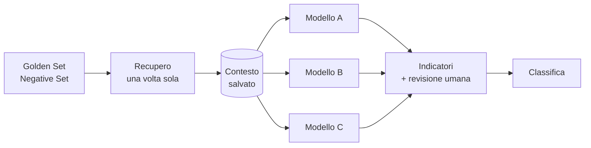

# Dike – benchmark di LLM locali per RAG

**Quale modello usare per un assistente che risponde sui documenti?** Il più grande? Il più famoso? Dike risponde con i dati: fa girare gli stessi controlli su più modelli open source in locale e li mette a confronto su qualità, rifiuti corretti, determinismo, tempi, memoria e tenuta sotto carico.

Come Dike, la dea del giudizio giusto, decide su prove misurate e non su impressioni.

*Dike is a reproducible benchmark for choosing a local LLM (via Ollama) for a RAG assistant: same retrieved context for every model, golden and negative question sets, double run for determinism, latency, memory and concurrency, with a ranked report and human review.*

---

## La regola d'oro: stesso contesto per tutti

Per ogni domanda il recupero dei passaggi avviene **una sola volta**, e ogni modello riceve **esattamente lo stesso prompt**. Cambia solo il modello che scrive la risposta. Altrimenti si finisce per confrontare il recupero, non i modelli. Ogni riga dei risultati porta l'impronta del prompt usato, quindi lo si può verificare.



## Cosa misura

| Area | Come |
|---|---|
| **Qualità** | sul Golden Set: l'articolo atteso compare tra le fonti? Il modello lo cita? Ha rifiutato una domanda che aveva risposta (falso negativo)? Ha citato fonti che non gli erano state date? |
| **Rifiuto** | sul Negative Set: quante domande fuori dominio riceve la risposta corretta "Non trovo questa informazione nei documenti."; ogni risposta data comunque è segnalata come possibile allucinazione |
| **Determinismo** | tutto il protocollo eseguito due volte (o N), con il confronto testuale delle risposte |
| **Tempi** | media, mediana, minimo, massimo, 90° percentile, timeout e nuovi tentativi |
| **Memoria** | quanta RAM occupa ogni modello caricato; con `--ram-max-gb` i modelli troppo grandi vengono esclusi per **vincolo hardware** |
| **Concorrenza** | richieste in parallelo (1, 2, 4…): Ollama le serve davvero insieme, le mette in coda, o le serve insieme rallentando? |

**Gli indicatori automatici non sostituiscono il giudizio umano.** Dike prepara un CSV di revisione con una colonna per il verdetto (OK / PARZIALE / ERRATA). Quando lo reimporti, la classifica viene ricalcolata. Finché i verdetti mancano, la qualità è una stima marcata come "(auto)".

Si possono anche fermare in anticipo i modelli troppo lenti, con `--stop-latenza-s`: se le prime risposte superano la soglia, il modello si scarta senza aspettare la fine.

## Risultati del benchmark che ha dato origine a Dike

Dike generalizza un confronto che ho fatto a mano per un assistente su documenti aziendali riservati: Golden Set di 20 domande, Negative Set di 8, server con 16 GB di RAM e solo CPU.

| Modello | Corrette /28 | Determinismo | Tempo medio | Esito |
|---|---|---|---|---|
| **gemma3:4b** | **28** | sì | 32,4 s | **scelto** |
| qwen2.5:7b | 27 | sì | 55,3 s | valido, più lento |
| llama3.2:3b | 27 | sì | 27,1 s | alternativa veloce |
| phi4-mini | 26 | sì | 30,8 s | citazioni imprecise |
| qwen2.5:3b | 22 | sì | 25,1 s | troppi falsi negativi |
| mistral 7B | – | – | 66,9 s | escluso: troppo lento |
| qwen2.5:14b | – | – | – | escluso: vincolo hardware |

Tre lezioni:

- **Il modello più accurato non era il più grande.** Un 4B ha battuto un 7B, impiegando poco più della metà del tempo.
- **Un modello "prudente" non è un modello sicuro.** 6 risposte negate su 20, quando la risposta c'era, rendono l'assistente inutile proprio dove serve.
- **La macchina decide.** Con 16 GB di RAM e solo CPU il limite pratico è la classe 7B.

Il resto è in [docs/benchmark-originale.md](docs/benchmark-originale.md): metodo, secondo giro dopo l'aggiornamento dell'hardware, esperimento sui prompt, perché una soglia sul punteggio di somiglianza non basta a riconoscere le domande fuori dominio, e test di parallelismo.

## Come si usa

Dike lavora su una Knowledge Base di [Clio](https://github.com/danielacolmenares/clio), che usa come libreria per il recupero e per il prompt. La Knowledge Base va prima caricata con Clio, e i modelli scaricati in Ollama.

```bash
pip install -r requirements.txt

# confronto tra modelli, protocollo eseguito due volte
python -m dike.cli esegui --kb demo --modelli gemma3:4b,llama3.2:3b,qwen2.5:7b --run 2 \
    --ram-max-gb 12 --stop-latenza-s 60 --stop-dopo 5

# tenuta sotto carico
python -m dike.cli concorrenza --modello gemma3:4b --paralleli 1,2,4

# dopo la revisione umana
python -m dike.cli verdetti risultati/demo_<data>/revisione_umana.csv
python -m dike.cli riepilogo risultati/demo_<data>
```

Ogni esecuzione crea una cartella `risultati/<kb>_<data>/` con il protocollo usato, il contesto, il dettaglio per domanda, la memoria, il CSV di revisione e il **riepilogo in Markdown** con la classifica.

## Test

**60 test automatici**, che non toccano la rete: Ollama e il recupero sono simulati, anche con un server finto che serve le richieste in coda o in parallelo per verificare la classificazione della concorrenza.

```bash
pip install -e /percorso/di/clio pytest
python -m pytest -q
```

## Limiti

- I criteri automatici (stima della qualità, comportamento prevalente, soglie di concorrenza) sono euristiche dichiarate, non giudizi.
- Il determinismo è un confronto esatto del testo: serve una generazione con temperatura 0 e seed fisso, come fa Clio.
- La variabile `OLLAMA_NUM_PARALLEL` non si legge dall'API: il report la spiega, non la riporta.

---

Progettato e sviluppato da **Daniela P Colmenares** · [danielacolmenares.it](https://www.danielacolmenares.it)
